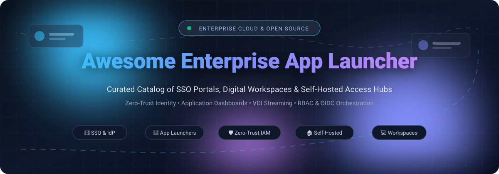

# 🚀 Awesome-Enterprise-App-Launcher

<p align="center">
  
</p>

<p align="center">
  <a href="https://github.com/ishandutta2007/Awesome-Awesome-Awesome"></a>
  <a href="https://discord.gg/jc4xtF58Ve"></a>
  <a href="https://github.com/ishandutta2007/Awesome-Enterprise-App-Launcher/stargazers"></a>
  <a href="https://github.com/ishandutta2007/Awesome-Enterprise-App-Launcher/network/members"></a>
  <a href="https://github.com/ishandutta2007/Awesome-Enterprise-App-Launcher/issues"></a>
  <a href="https://github.com/ishandutta2007/Awesome-Enterprise-App-Launcher/blob/main/LICENSE"></a>
  <a href="https://github.com/ishandutta2007"></a>
</p>

---

> **🌟 Curated List of Enterprise App Launchers, SSO Portals, Identity Access Dashboards & Self-Hosted Workspaces 🌟**
>
> Discover the best commercial SaaS platforms and open-source self-hosted alternatives for enterprise single sign-on (SSO) app launchers, employee application catalogs, OIDC identity launchpads, and virtual workspace dashboards.

---

## 📑 Table of Contents

- [🌐 Sector Overview & Market Dynamics](#-sector-overview--market-dynamics)
- [🏢 SaaS/Hosted Platforms](#-saashosted-platforms)
- [💻 Open-Source GitHub Projects](#-open-source-github-projects)
- [🛠️ Architecture & Deployment Patterns](#️-architecture--deployment-patterns)
- [🤝 How to Contribute](#-how-to-contribute)
- [💖 Support & Sponsorship](#-support--sponsorship)
- [📊 Star History](#-star-history)
- [⚠️ Disclaimer](#️-disclaimer)

---

## 🌐 Sector Overview & Market Dynamics

The enterprise app launcher, single-sign-on (SSO) portal, and digital identity workspace market is valued between **$25 billion and $30 billion globally**, projected to surge past **$70 billion over the next decade** at a **12–15% CAGR**. This dramatic expansion is propelled by zero-trust architecture adoption, compliance requirements (SOC 2, ISO 27001, HIPAA), SaaS sprawl governance, and hybrid/remote work operational demands.

The sector demonstrates a distinctive **bifurcated market structure**:
- **Winner-Take-Most Top-End Concentration**: Dominant hyperscalers and cybersecurity conglomerates (primarily Microsoft Entra ID and Okta) control the overwhelming majority of large enterprise contracts due to deep ecosystem bundling (e.g., Microsoft 365 E3/E5) and complex zero-trust conditional access capabilities.
- **Dynamic Fragmentation in Self-Hosted & Specialized Tiers**: Mid-market organizations, privacy-first companies, and dev-heavy teams increasingly leverage flexible open-source identity hubs and lightweight app dashboards to prevent vendor lock-in and avoid exorbitant per-seat licensing penalties.

---

## 🏢 SaaS/Hosted Platforms

The following enterprise platforms provide managed Single Sign-On (SSO) portals, application directories, centralized role-based access management, and automated provisioning.

*Sorted by company valuation / market cap in descending order:*

| 🏷️ Product | 💰 Company Valuation / Revenue | 💳 Pricing (Starting Tier) | 🎁 Free Tier / Trial Limits | 🔍 Description & Key Features |
| :--- | :--- | :--- | :--- | :--- |
| **Microsoft My Apps** | ~$3.88 Trillion (Market Cap) | **$0** (included with Entra ID Free); Paid starts at **$7.00/user/mo** (Entra ID P1) | **Free forever** up to 50,000 directory objects (expands to 300,000 objects with custom domain; no conditional access SLA); Paid tiers offer 30-day free trial | Application launcher within Microsoft Entra ID. Native SSO tile portal, self-service app discovery, and access package requests for Microsoft 365 environments. |
| **Atlassian Start / Home** | ~$52 Billion (Market Cap) / ~$6.57B ARR | **Free** with Atlassian Cloud; core plans start at **$7.75/user/mo** (Jira Standard) | **Free forever** up to 10 users per cloud product instance; Paid tiers offer 7-to-30-day free trial | Centralized cross-product workspace hub and switcher across Jira, Confluence, Trello, and connected third-party Atlassian cloud apps. |
| **Okta End-User Dashboard** | ~$38 Billion (Market Cap) / ~$3.0B ARR | **$6.00/user/mo** (Workforce Identity Starter tier, annual billing, ~$1,500 min spend) | **30-day free trial** with full platform capabilities (SSO, MFA, Universal Directory); Developer edition free tier available | Industry-standard tile launchpad featuring conditional access, passwordless verify, contextual risk analysis, and seamless app requests. |
| **Rippling App Launcher** | $16.8 Billion (Valuation) / >$1.0B ARR | **$8.00/user/mo** (Core Unity Platform) + **~$6.00/user/mo** (IAM & App Access module) | **No free forever tier**; interactive sandbox product tours and pilot trial access provided upon enterprise inquiry | Unified employee identity and app access dock tightly integrated with automated HR onboarding, payroll, and MDM endpoint hardware management. |
| **Citrix Workspace** | $16.5 Billion (Acquisition Valuation) / ~$3.2B Revenue | **$10.00/user/mo** (Citrix DaaS Standard starting tier, BYO cloud infrastructure) | **No free forever tier**; Proof-of-concept enterprise trial available upon request via sales partners (typically 30-day trial) | Enterprise virtual application and desktop launchpad combining web SSO bookmarks with low-latency remote application streaming and microapps. |
| **PingOne Dock** | $16.5 Billion (Acquisition Valuation by Thoma Bravo) / ~$300M Revenue | **$3.00/user/mo** (PingOne for Workforce Essential tier; 5,000 user contract minimum) | **30-day free trial** with full authentication, MFA, orchestration, and SSO directory access; no permanent free tier | Employee dock and customized application directory built into Ping Identity's zero-trust workforce identity platform. |
| **Omnissa / VMware Workspace ONE** | $4.0 Billion (Acquisition Valuation by KKR) / ~$1.5B ARR | **$3.00/user/mo** (Employee Essentials tier for identity, SSO, and digital app catalog) | **No free forever tier**; 30-day proof-of-concept evaluation trial available via Omnissa enterprise channels | Digital workspace app catalog combining unified endpoint management (UEM) with secure enterprise single sign-on app delivery. |
| **JumpCloud User Portal** | $2.63 Billion (Valuation) | **$9.00/user/mo** (Device Management) or **$11.00/user/mo** (SSO package) | **30-day full-feature free trial** (legacy accounts created prior to Feb 2024 retain 10 users / 10 devices free limit) | Cloud directory user portal delivering SSO application access, RADIUS, LDAP, and device management without Active Directory requirements. |
| **OneLogin Portal** | ~$500 Million (Acquisition Valuation by One Identity) / ~$25M Revenue | **$2.00/user/mo** (Starter Directory & Workflows); Full SSO packages from **~$4–$8/user/mo** | **30-day free trial** with complete SSO, SmartFactor Authentication, and portal capabilities; no permanent free production tier | Single-sign-on launchpad, cloud directory, and multi-factor authentication hub within OneLogin IAM. |
| **Workgrid** | Wholly-owned subsidiary of Liberty Mutual ($50B+ Revenue); ~$5M ARR scale | **~$5.00/user/mo** (Baseline enterprise digital assistant entry tier, custom enterprise quote) | Custom pilot evaluation trial available on request (no self-serve free forever tier; wound down mid-2025) | Digital workplace assistant and micro-app launcher aggregating internal communication streams, tasks, and corporate intranet links. |

---

## 💻 Open-Source GitHub Projects

Curated open-source projects for self-hosted application dashboards, SSO portals, identity providers with user launchpads, and embedded application switchers.

*Sorted by GitHub Stars_Count in descending order:*

### 1. [Homepage](https://github.com/gethomepage/homepage) [](https://github.com/gethomepage/homepage/stargazers)
* **Description**: A modern, hyper-fast, secure, and highly customizable application dashboard and startpage for self-hosted infrastructure and internal tools.
* **Key Features**: Over 100 native service widgets (Docker, Kubernetes, Proxmox, Grafana), instant search, YAML-driven layout, secure API proxying, and built-in OIDC/auth headers integration.
* **Tech Stack**: Next.js (React), Node.js, Tailwind CSS | **License**: GPL-3.0 | **Deployment**: Docker, Kubernetes.

### 2. [Authelia](https://github.com/authelia/authelia) [](https://github.com/authelia/authelia/stargazers)
* **Description**: The open-source authentication and authorization server providing two-factor authentication and single sign-on (SSO) with an integrated user dashboard and session launchpad.
* **Key Features**: Lightweight companion for reverse proxies (Traefik, NGINX, Caddy, Envoy), OpenID Connect (OIDC) provider, WebAuthn/FIDO2 hardware keys, TOTP, and LDAP/file user databases.
* **Tech Stack**: Go (Golang), React, TypeScript | **License**: Apache-2.0 | **Deployment**: Docker, Kubernetes, Bare Metal.

### 3. [Authentik](https://github.com/goauthentik/authentik) [](https://github.com/goauthentik/authentik/stargazers)
* **Description**: An all-in-one open-source Identity Provider (IdP) featuring a built-in user application launchpad designed to emulate the Okta Dashboard experience.
* **Key Features**: End-user application library with custom icon tiles, SAML 2.0, OpenID Connect, OAuth 2.0, LDAP outpost proxies, flexible enrollment/authentication flows, and RBAC visibility rules.
* **Tech Stack**: Python (Django), Go, Web Components | **License**: MIT | **Deployment**: Docker Compose, Helm (Kubernetes).

### 4. [Zitadel](https://github.com/zitadel/zitadel) [](https://github.com/zitadel/zitadel/stargazers)
* **Description**: Cloud-native identity and access management platform offering turnkey multi-tenancy, authentication, and user access portals.
* **Key Features**: Out-of-the-box user console, B2B multi-tenancy, passwordless WebAuthn authentication, fine-grained RBAC authorization, and comprehensive audit trails.
* **Tech Stack**: Go (Golang), Angular / Next.js | **License**: Apache-2.0 | **Deployment**: Docker, Kubernetes, CockroachDB/PostgreSQL.

### 5. [Homer](https://github.com/bastienwirtz/homer) [](https://github.com/bastienwirtz/homer/stargazers)
* **Description**: A dead-simple, static, yaml-configured dashboard and service launcher for homelabs and intranet servers.
* **Key Features**: Zero backend database requirement, static file distribution, responsive mobile-friendly tile grid, custom theming, keyboard shortcuts, and tag grouping.
* **Tech Stack**: Vue.js, JavaScript | **License**: Apache-2.0 | **Deployment**: Docker, NGINX static hosting.

### 6. [Heimdall](https://github.com/linuxserver/Heimdall) [](https://github.com/linuxserver/Heimdall/stargazers)
* **Description**: An elegant, mature application dashboard and bookmark launcher for organizing enterprise web apps and homelab services.
* **Key Features**: Clean tile interface, enhanced apps with live data badges, multi-user support, tag-based categorization, and simple browser search integration.
* **Tech Stack**: PHP (Laravel), SQLite/MySQL | **License**: MIT | **Deployment**: Docker (linuxserver.io), Podman.

### 7. [Flame](https://github.com/pawelmalak/flame) [](https://github.com/pawelmalak/flame/stargazers)
* **Description**: A minimalist, customizable startpage and application launcher with integrated Docker container detection.
* **Key Features**: Automatic container sync via Docker labels, integrated weather widget, custom bookmark categories, GUI configuration editor, and PIN-protected admin settings.
* **Tech Stack**: Node.js, React | **License**: MIT | **Deployment**: Docker.

### 8. [Organizr](https://github.com/causefx/Organizr) [](https://github.com/causefx/Organizr/stargazers)
* **Description**: An HTPC/Homelab and service organizer that merges multiple web services into a single tabbed intranet portal.
* **Key Features**: Embedded tab iFrames, user access control tiers (Admin, User, Guest), SSO integration with Plex/Emby/OAuth, customizeable theme engine, and notification hooks.
* **Tech Stack**: PHP, JavaScript, SQLite | **License**: GPL-3.0 | **Deployment**: Docker, NGINX, Apache.

### 9. [Kanidm Application Portal](https://github.com/kanidm/kanidm) [](https://github.com/kanidm/kanidm/stargazers)
* **Description**: Fast, modern, and secure identity management platform written in Rust with a native web app launcher portal for registered services.
* **Key Features**: Built-in OAuth2/OIDC provider, WebAuthn-first authentication, POSIX/LDAP support, memory-safe architecture, and permission-based user application directory.
* **Tech Stack**: Rust, WebAssembly (Wasm) | **License**: MPL-2.0 | **Deployment**: Docker, Cargo, Linux Bare Metal.

### 10. [appswitcher-server](https://github.com/it-at-m/appswitcher-server) [](https://github.com/it-at-m/appswitcher-server/stargazers)
* **Description**: Enterprise icon-based application switcher bar built by the City of Munich (it@M) for embedding Google App Launcher-style menus directly into corporate web applications.
* **Key Features**: IFrame embeddable, YAML application registry, tag-based micro-frontend filtering, and native Keycloak audience token integration ensuring employees only see apps they have rights to view.
* **Tech Stack**: Java (Spring Boot), Vue.js, Vuetify | **License**: MIT | **Deployment**: Docker, Spring Boot JAR.

### 11. [Pocket ID Dashboard](https://github.com/mzgaljic/pocket-id-dashboard) [](https://github.com/mzgaljic/pocket-id-dashboard/stargazers)
* **Description**: Community-built user portal and application launcher for Pocket ID (lightweight OIDC identity provider).
* **Key Features**: Clean tile dashboard of assigned OIDC clients, in-app access request workflows for unassigned applications, admin approval controls, and PKCE-secured sign-in.
* **Tech Stack**: Node.js, Vue.js (NuxtUI) | **License**: MIT | **Deployment**: Docker.

### 12. [Beeline](https://github.com/sapn95/beeline) [](https://github.com/sapn95/beeline/stargazers)
* **Description**: Fast, keyboard-first browser extension launcher for Microsoft Entra ID / My Apps SSO applications.
* **Key Features**: Instant fuzzy search across corporate applications, smart frequency learning, direct sync with `myapplications.microsoft.com`, and 100% private client-side execution with zero telemetry.
* **Tech Stack**: JavaScript (WebExtensions API) | **License**: MIT | **Deployment**: Chrome Web Store, Firefox Add-ons.

---

## 🛠️ Architecture & Deployment Patterns

When selecting an enterprise app launcher solution, determine your architectural boundary:

```
┌────────────────────────────────────────────────────────────────────────┐
│                      Enterprise App Launcher Tiers                     │
├──────────────────────────┬─────────────────────────────────────────────┤
│ 1. Identity-Native       │ Fully managed IAM with built-in SSO tiles,  │
│    Portals               │ conditional access & automated provisioning │
│    (Okta, Entra, Authentik) │ e.g. Okta Dashboard, Microsoft My Apps    │
├──────────────────────────┼─────────────────────────────────────────────┤
│ 2. Self-Hosted Visual    │ Centralized launchpad linking to internal   │
│    Dashboards            │ services with widget metrics & bookmarks    │
│    (Homepage, Heimdall)  │ e.g. Homepage, Homer, Flame, Organizr       │
├──────────────────────────┼─────────────────────────────────────────────┤
│ 3. Embedded Application  │ Modular navigation bar embedded into header │
│    Switchers             │ via iframe with Keycloak token filtering    │
│    (appswitcher-server)  │ e.g. Google-style 9-dot launcher bar        │
├──────────────────────────┼─────────────────────────────────────────────┤
│ 4. Client-Side Quick     │ Keyboard-first browser extensions caching   │
│    Launchers (Beeline)   │ corporate SSO catalogs for instant launch   │
└──────────────────────────┴─────────────────────────────────────────────┘
```

---

## 🤝 How to Contribute

Contributions are warmly welcomed! Help keep this enterprise directory accurate, comprehensive, and up-to-date:

1. 🍴 **Fork the repository** on GitHub.
2. 🌿 **Create a new branch**: `git checkout -b feature/add-new-launcher`.
3. 📝 **Add or update an entry**: Ensure description adheres to factual, neutral specifications with license, tech stack, and clear deployment instructions.
4. 🚀 **Commit your changes**: `git commit -m "Add new enterprise launcher: <tool-name>"`.
5. 📬 **Submit a Pull Request** with a concise summary of the addition.

---

## 💖 Support & Sponsorship

If you find this curated collection valuable for your infrastructure, identity architecture, or homelab research:

* ⭐ **Star this repository** to help others discover it!
* 🍴 **Fork and share** with your DevOps, IT security, and cloud engineering peers.
* ☕ **Support future open-source curation and development**:
  
  [](https://github.com/sponsors/ishandutta2007)

---

## 📊 Star History

[](https://star-history.dera.page/#ishandutta2007/Awesome-Enterprise-App-Launcher&type=date&legend=top-left)

---

## ⚠️ Disclaimer

- This repository is a **community-curated index** and does not constitute an endorsement of any vendor, software project, or security model.
- App launchers handling enterprise Single Sign-On (SSO) and access permissions must adhere to data protection regulations (GDPR, CCPA, HIPAA) and enforce zero-trust conditional access policies.
- Self-hosted applications require ongoing vulnerability patching, secure reverse-proxy configuration, TLS termination, and proper authentication layers before exposing endpoints to public networks.

---

<p align="center">
  <b>Built with ❤️ for IT administrators, Identity &amp; Access engineers, and cloud architects worldwide.</b>
</p>
